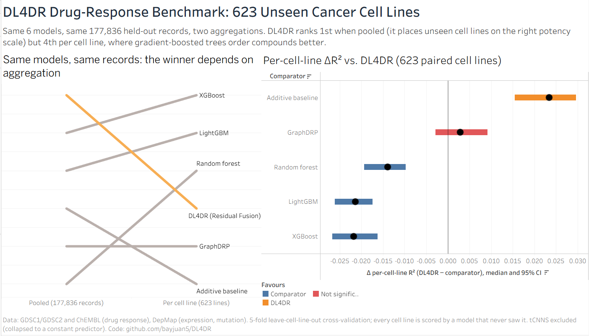

# DL4DR Drug-Response Benchmark — Tableau Public Dashboard

Interactive dashboard of benchmark results for **DL4DR (Two-Tower Residual Late Fusion)**, a drug-response
prediction model evaluated on unseen cancer cell lines (5-fold leave-cell-line-out cross-validation, 623 held-out
cell lines, 177,836 held-out drug-response records).

- Tableau workbook: [`DL4DR_dashboard_v3.twbx`](DL4DR_dashboard_v3.twbx) (open with the free Tableau Desktop Public Edition)
- Dashboard build script: [`build_dashboard.py`](build_dashboard.py) — adds the *Overview* dashboard to a workbook containing the two sheets:
  `python build_dashboard.py <input.twbx> <output.twbx>`
- Model code: https://github.com/bayjuan5/DL4DR
- Author: Beibei Huang, Ph.D. (iMDLab, Houston, TX)

## The story the dashboard tells

1. **The ranking depends on how you aggregate.** Pooled over all records, DL4DR ranks 1st on every metric.
   Computed per cell line, gradient-boosted trees (XGBoost, LightGBM) lead and DL4DR ranks 4th.
   Pooled R² rewards placing each unseen cell line at the right overall potency level; per-cell-line R²
   rewards ordering compounds correctly *within* a cell line.
2. **Gains over the additive baseline are real but uneven** across the 623 held-out cell lines and the 5 folds.
3. **Zero-shot transfer by tissue:** a breast-only model transfers to 601 external cell lines across 27
   tissue types; performance falls with distance from breast tissue (haematopoietic lowest).
4. **Interpretability:** GradCAM recovers known breast-cancer drivers (TP53, BRCA2) but does not let them dominate.

## Data files (`data/`)

All files are small summary tables (no raw GDSC records). Long ("tidy") format where useful, so Tableau can
filter by model, metric and aggregation.

| File | Rows | Content |
|---|---|---|
| `00_kpis.csv` | 10 | Headline counts for KPI tiles (cell lines, compounds, records, density) |
| `01_model_metrics.csv` | 96 | 6 models × 4 metrics (RMSE, Pearson, Spearman, R²) × 2 aggregations; `statistic` = value (pooled) or median / mean / std (per cell line); `rank` on the headline statistic |
| `02_paired_vs_dl4dr.csv` | 5 | Per-cell-line R² of DL4DR minus each comparator, paired over 623 cell lines: median Δ, 95% CI, wins/losses, Wilcoxon p, rank-biserial effect size, Bonferroni significance (α = 0.01) |
| `03_vs_additive_baseline.csv` | 5 | Each model vs. the train-only additive baseline: wins, losses, win rate, substantial wins (ΔR² > 0.02), mean / worst Δ, sign-test p |
| `04_cv_folds.csv` | 5 | Per-fold sizes, early-stopping epoch, full model vs. gate-off (λ ≡ 0) ablation vs. additive baseline |
| `05_zero_shot_by_tissue.csv` | 23 | Mean ± SD R² by tissue type for the breast-trained model on 601 external cell lines (tissues with ≥ 2 lines) |
| `06_gradcam_driver_genes.csv` | 50 | How many of 51 breast cell lines rank each gene as a top GradCAM driver; known driver vs. novel candidate |
| `07_breast_top10_residual_gain.csv` | 10 | Top-10 breast cell lines by residual-fusion gain over the memorization-only model |

### Notes on values
- **tCNNS is excluded**, as in the paper: it collapsed to a constant predictor on this compound library.
- `05_zero_shot_by_tissue.csv`: haematopoietic mean R² (0.073) is from the paper text; the other tissue means
  and SDs were **read off the published figure and are approximate (± ~0.01)**. Column `value_source` marks this.
  Replace with exact values from `external_validation.py` output before publishing.
- Higher is better for all metrics except RMSE (`higher_is_better` column).

## Data sources and citation

Drug response from GDSC1/GDSC2 (Wellcome Sanger Institute) and ChEMBL; cell-line expression and mutation
from DepMap. This repository contains only derived summary statistics. Raw GDSC data are available at
https://www.cancerrxgene.org under Sanger's terms of use.

- Garnett MJ, et al. Systematic identification of genomic markers of drug sensitivity in cancer cells. *Nature* 2012.
- Yang W, et al. Genomics of Drug Sensitivity in Cancer (GDSC). *Nucleic Acids Res.* 2013.
- Tsherniak A, et al. Defining a cancer dependency map. *Cell* 2017.
